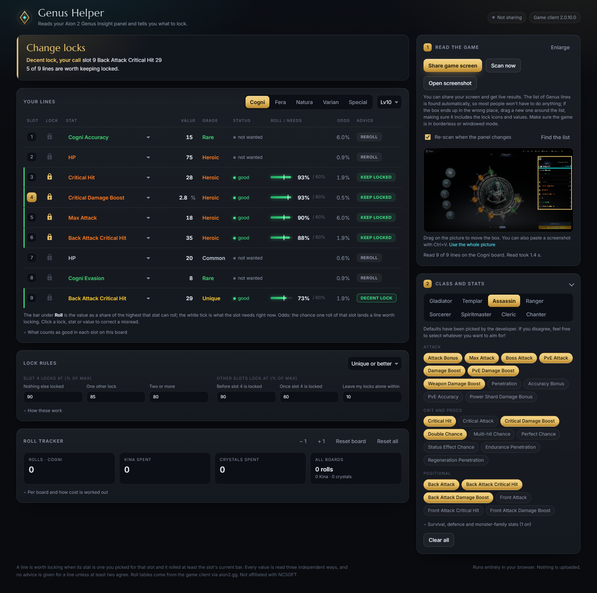

# Genus Helper

A lock advisor for **Aion 2 Genus Insight**. It reads the Genus Insight panel straight off your screen and tells you which lines to lock, which to unlock and which to reroll, based on the stats you want and how high each line rolled.

**Use it here: https://uix0.github.io/aion2-genus-helper/**

It is a single web page. Nothing is installed and nothing is uploaded: the screen capture, the reading and the advice all run in your browser.



## Using it

1. Open https://uix0.github.io/aion2-genus-helper/ in Chrome or Edge (or download the repository and open `index.html`).
2. Pick your class under **Class and stats**. The defaults are a starting point; switch any stat on or off.
3. Press **Share game screen** and choose the game window. Open the Genus Insight tab in game.
4. The list of lines is found automatically and read again every time it changes. The verdict at the top says what to lock or unlock.

The game has to run in borderless or windowed mode; exclusive fullscreen usually captures as a black picture. You can also paste a screenshot with Ctrl+V or drop an image on the page.

## What it does

- **Reads the panel live.** Board, Insight level, stat names, values, lock icons and grade colours. The first read of an area takes about half a second, later ones about a third.
- **Checks every value three ways.** Two text readers and a shape matcher that knows the game's own digits read each value independently. If all three agree the value is used silently; if two agree the line is marked "2 of 3"; if none agree the page refuses to give advice for that line until you type the value in.
- **Knows what each slot can roll.** A line only counts as good if the stat is one you picked *for that slot*. On slots 4 and 7, only the stats unique to that slot count, so an Accuracy line on slot 4 is always a reroll.
- **Lock rules you control.** Before slot 4 is locked, other slots only earn a lock at a very high roll (90% of the maximum by default), and each such lock lowers what slot 4 has to roll (90 / 85 / 80%). Once slot 4 is locked the other slots drop to a lower bar (60%). A line you already have locked that is close to its bar is left alone.
- **Shows the odds.** For every slot, the chance that one roll lands a line worth locking.
- **Tracks your rolls.** Rolls, Kina and Soul Crystals spent, per board and in total, priced by how many lines were locked at each roll.

## Limits worth knowing

- English game client only: stat names are matched against the English names.
- Tested on real screenshots at 2560x1440 and 1920x1080, and on resized screenshots at 3840x2160, 1600x900 and 1280x720. At 1280x720 values are still read correctly but more lines show "2 of 3".
- The roll tables come from the game client (version at the top of `data/options.js`) via aion2.gg. After a game patch that changes Genus Insight they need refreshing.
- The roll price for 8 locked lines is an estimate; the others were read off the Analyze button in game.
- The class defaults are one player's opinion. Change them in `data/classes.js`.
- It gives advice. It never touches the game, and you decide whether to roll.

## Hosting on GitHub Pages

It is a plain static site with no build step, so Pages can serve the repository as it is:

1. Push the repository to GitHub.
2. Repository **Settings → Pages → Build and deployment → Deploy from a branch**, pick your default branch and the `/ (root)` folder, and save.
3. The site appears at `https://uix0.github.io/aion2-genus-helper/` after a minute or two.

Screen sharing needs a secure page, which GitHub Pages is. The page loads its text reader (tesseract.js) and fonts from public CDNs, so it needs internet access the first time.

## Project layout

```
index.html         the page
app.css            styles
app.js             everything the page does: lock rules, screen reading, rendering
data/options.js    what every slot on every board can roll, with ranges and odds
data/classes.js    default stat picks per class
data/glyphs.js     the game's digit shapes for the shape reader
docs/              the screenshot above
```

There is no build step and no framework. Edit a file, reload the page.

## License

[PolyForm Noncommercial License 1.0.0](LICENSE.md). You are free to use, change and share this code for any noncommercial purpose: personal use, hobby projects, study, and so on. Commercial use, including running it on a site that makes money, is not allowed without permission from the author.

Required Notice: Copyright (c) 2026 uix0 (https://github.com/uix0)

This covers the code in this repository. The roll tables in `data/` are game data collected by aion2.gg and are not mine to license.

## Credits

Roll tables: [aion2.gg](https://aion2.gg). Text reading: [tesseract.js](https://github.com/naptha/tesseract.js). Aion 2 is a trademark of NCSOFT; this project is not affiliated with or endorsed by NCSOFT.
